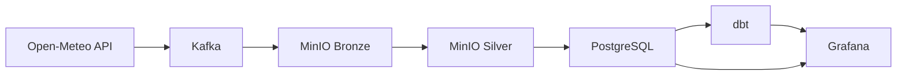

# 🌦️ Lakehouse Pipeline Météo — Kafka → MinIO → PostgreSQL → dbt → Grafana

Pipeline de données de bout en bout (architecture **Lakehouse** : Bronze → Silver → Gold) alimenté par l'API météo **Open-Meteo**, orchestré par **Apache Airflow**, avec visualisation dans **Grafana**.

---

## 📌 Architecture



**Orchestration** : Apache Airflow (DAG `lakehouse_pipeline`)

---

## 🛠️ Stack technique

| Outil | Rôle | Couche |
|---|---|---|
| **Open-Meteo** | API météo gratuite (sans clé) | Source |
| **Kafka** | File d'attente fiable entre production et consommation | Ingestion |
| **MinIO** | Stockage objet S3-compatible (données brutes + nettoyées) | Bronze + Silver |
| **PostgreSQL** | Entrepôt de données relationnel | Silver + Gold |
| **dbt** | Transformation SQL et modélisation métier | Gold |
| **Grafana** | Visualisation et dashboards | Restitution |
| **Airflow** | Orchestration du pipeline | Orchestration |
| **Docker** | Conteneurisation de tous les services | Infrastructure |

---

## 📂 Structure du projet

```
lakehouse-weather-pipeline/
├── docker-compose.yml          # Tous les services Docker
├── init.sql                    # Création automatique de la base analytics
├── requirements.txt            # Dépendances Python
├── .gitignore                  # Fichiers ignorés par Git
├── producer.py                 # Appelle Open-Meteo → Kafka
├── consumer_to_bronze.py       # Kafka → MinIO Bronze
├── silver_to_minio.py          # Bronze → Silver (nettoyage)
├── load_postgres.py            # Silver → PostgreSQL
├── dags/
│   └── pipeline_dag.py         # DAG Airflow (orchestration)
│   models/
│   └── gold_meteo.sql      # Modèle dbt (couche Gold)
├── gold_project/
│   ├── dbt_project.yml         # Configuration du projet dbt
│   └── profiles.yml            # Configuration dbt (PostgreSQL)
└── README.md
```

---

## 🚀 Lancement du projet

### 1. Prérequis

- Docker Desktop
- Python 3.12 (avec `venv`)
- Les bibliothèques Python : `kafka-python`, `minio`, `pandas`, `pyarrow`, `sqlalchemy`, `psycopg2-binary`, `requests`, `dbt-postgres`
- Un fichier `init.sql` à la racine (crée la base `analytics` automatiquement au premier démarrage de PostgreSQL)

### 2. Démarrer les services

```bash
docker compose up -d
```

Vérifier que tout tourne :

```bash
docker ps
```

Les conteneurs doivent être en `Up` : `minio`, `kafka-lakehouse`, `postgres`, `airflow-webserver`, `airflow-scheduler`, `grafana`. Le conteneur `airflow-init` s'exécute une fois puis s'arrête (c'est normal).

### 3. Lancer le pipeline manuellement (Windows)

```bash
# 1. Récupérer les données météo depuis Open-Meteo → Kafka
python producer.py

# 2. Lire Kafka → MinIO Bronze
python consumer_to_bronze.py

# 3. Nettoyer → MinIO Silver
python silver_to_minio.py

# 4. Charger → PostgreSQL
python load_postgres.py

# 5. Créer la vue Gold avec dbt
cd gold_project && dbt run --profiles-dir .
```

### 4. Lancer le pipeline via Airflow (automatisé)

> **Note** : le conteneur `airflow-init` s'exécute une fois (migrations + création de l'utilisateur admin) puis s'arrête. C'est normal.

Ouvrir `http://localhost:8080` (admin / admin), activer le DAG `lakehouse_pipeline`, puis cliquer sur **Trigger DAG**.

Le DAG exécute automatiquement les 5 étapes dans l'ordre : `produce` → `consume` → `silver` → `load` → `dbt`.

---

## 🔄 Reproductibilité

Le projet est conçu pour être **cloné et lancé sans intervention manuelle** :

1. `git clone <repo>`
2. `docker compose up -d`
3. PostgreSQL exécute `init.sql` au premier démarrage → crée la base `analytics`
4. Airflow exécute `airflow-init` → migre la base et crée l'utilisateur admin
5. Ouvrir Airflow (`http://localhost:8080`) et lancer le DAG

Aucune commande SQL manuelle n'est nécessaire.

---

## 🌐 Interfaces web

| Service | URL | Identifiants |
|---|---|---|
| **Airflow** | http://localhost:8080 | admin / admin |
| **Grafana** | http://localhost:3000 | admin / admin |
| **MinIO Console** | http://localhost:9003 | minioadmin / minioadmin123 |
| **Kafka** | localhost:9092 | — |

---

## 📊 Visualisation dans Grafana

1. Ouvrir `http://localhost:3000` (admin / admin)
2. Ajouter une source de données **PostgreSQL** :
   - Host : `postgres:5432` (nom du service Docker, pas `localhost`)
   - Database : `analytics`
   - User : `airflow`
   - Password : `airflow`
   - SSL mode : `disable`
3. Créer un panel avec la requête :
   ```sql
   SELECT ville, temp_moyenne, humidite_moyenne, vent_max FROM gold_meteo;
   ```

Résultat attendu : un graphique montrant la température moyenne par ville (Paris, Lyon, Marseille).

---

## 🔄 Le flux de données, étape par étape

1. **`producer.py`** interroge l'API **Open-Meteo** pour plusieurs villes (Paris, Lyon, Marseille) et envoie les données météo (température, humidité, vent) dans le topic Kafka `events`.
2. **`consumer_to_bronze.py`** lit Kafka et écrit les données brutes en Parquet dans `bronze/events/`.
3. **`silver_to_minio.py`** lit Bronze, nettoie (dédoublonnage) et écrit dans `silver/events/`.
4. **`load_postgres.py`** lit Silver et charge les données dans PostgreSQL (`events_clean`).
5. **`dbt run`** transforme `events_clean` en vue `gold_meteo` (agrégats métier : température moyenne par ville, etc.).
6. **Grafana** affiche `gold_meteo` dans un dashboard.

---

## 🌡️ Données météo (Open-Meteo)

L'API Open-Meteo est **gratuite et ne nécessite aucune clé**. Le producteur récupère :

- **Température** (`temperature_2m`)
- **Humidité relative** (`relative_humidity_2m`)
- **Vitesse du vent** (`wind_speed_10m`)

Pour plusieurs villes : Paris, Lyon, Marseille.

Exemple de données envoyées dans Kafka :

```json
{
  "id": 5387350821178740268,
  "ville": "Paris",
  "temperature": 13.1,
  "humidite": 60,
  "vent": 18.8,
  "timestamp": 1792598441.35
}
```

---

## 🎯 Compétences démontrées

- **Data Engineering** : pipeline ETL/ELT complet, ingestion, stockage, transformation
- **Big Data** : Kafka, MinIO (S3-compatible), Parquet
- **Orchestration** : Airflow (DAG, dépendances, retries)
- **Modélisation** : dbt (SQL versionné, tests, documentation)
- **Visualisation** : Grafana
- **Infrastructure** : Docker Compose (réseau, volumes, variables d'environnement)
- **API** : consommation d'une API REST (Open-Meteo)
- **Résolution de problèmes** : configuration réseau Docker (listeners Kafka, DNS entre conteneurs), compatibilité de versions (pandas, SQLAlchemy, dbt)

---

## ⚠️ Difficultés rencontrées et solutions

| Difficulté | Solution |
|---|---|
| **Kafka inaccessible depuis Airflow** | Configuration de deux listeners (`PLAINTEXT://localhost:9092` pour Windows, `INTERNAL://kafka:29092` pour Docker) + ajout de Kafka au réseau `lakehouse-net` |
| **MinIO inaccessible depuis Airflow** | Ajout de MinIO au réseau `lakehouse-net` (nom de service résolu par Docker) |
| **dbt ne trouvait pas `profiles.yml`** | Montage du fichier dans le conteneur via un volume Docker (`./gold_project/profiles.yml:/opt/airflow/gold_project/profiles.yml`) |
| **Conflit de port PostgreSQL** | Changement du port exposé (`5434` au lieu de `5432`, déjà occupé par PostgreSQL local) |
| **`if_exists='replace'` échouait** | Suppression de la vue `gold_meteo` avant de recréer la table (`DROP VIEW CASCADE`) |
| **`delete_rows` non supporté dans Airflow** | Utilisation de `DELETE FROM` + `append` (compatible avec toutes les versions de pandas) |
| **`conn.commit()` non supporté dans SQLAlchemy 1.4** | Utilisation de `engine.begin()` (transaction automatique) |
| **Kafka accumulait des milliers de messages** | Suppression du volume Kafka (`kafka_kafka-data`) et recréation du topic `events` |
| **`airflow db init` supprimé** | Remplacé par `airflow db migrate` (depuis Airflow 2.7+) |
| **Conteneur Airflow instable (webserver + scheduler dans le même conteneur)** | Séparation en deux services : `airflow-webserver` et `airflow-scheduler` |
| **Base `analytics` absente après déplacement du projet** | Ajout de `init.sql` monté dans `/docker-entrypoint-initdb.d/` pour créer la base automatiquement |
| **Erreur 403 sur les logs Airflow** | Ajout de `AIRFLOW__WEBSERVER__SECRET_KEY` identique dans le webserver et le scheduler |
| **`dbt_project.yml` introuvable dans Airflow** | Vérification du montage de `gold_project/` dans le conteneur |
| **Conflit de port MinIO / HDFS** | MinIO déplacé sur `9002/9003`, HDFS garde `9000` |

---

## 🧹 Fichiers ignorés (`.gitignore`)

```
__pycache__/
*.py[cod]
.venv/
venv/
gold_project/target/
gold_project/logs/
gold_project/.user.yml
airflow/logs/
.DS_Store
.idea/
.vscode/
```

Ces fichiers sont générés automatiquement (cache Python, logs dbt, logs Airflow) et ne doivent pas être versionnés.

---

## 📝 Licence

Projet personnel — libre d'utilisation.
